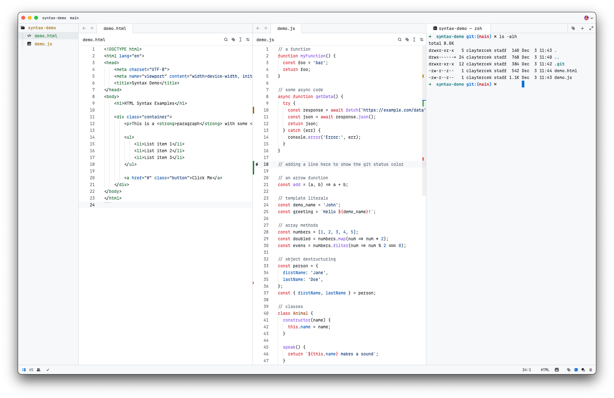
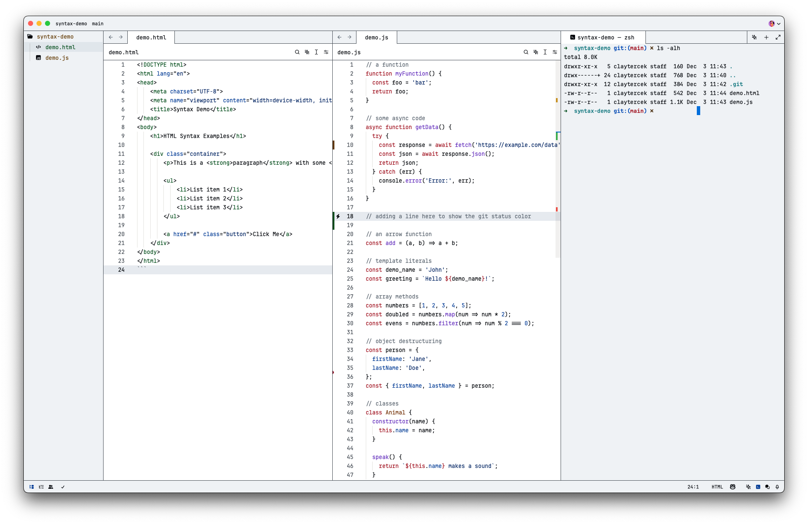
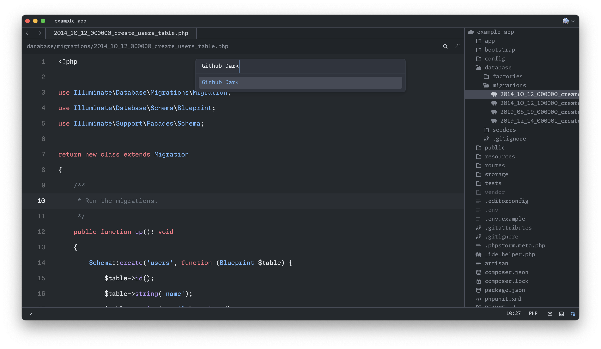
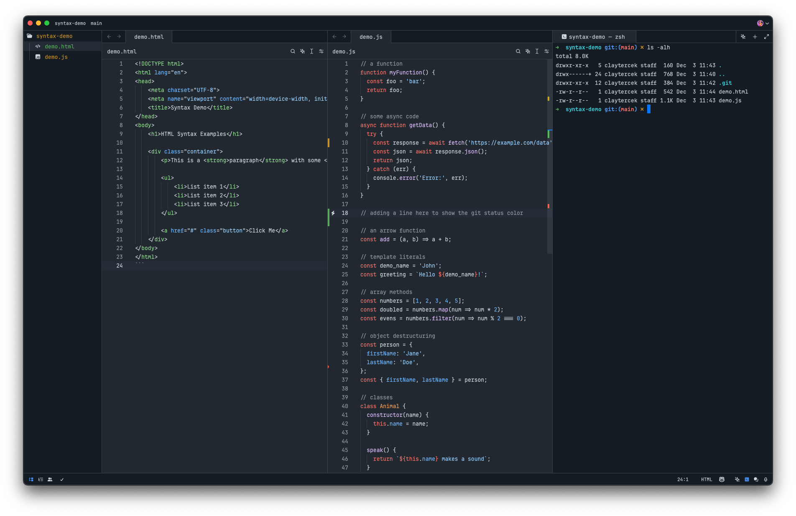
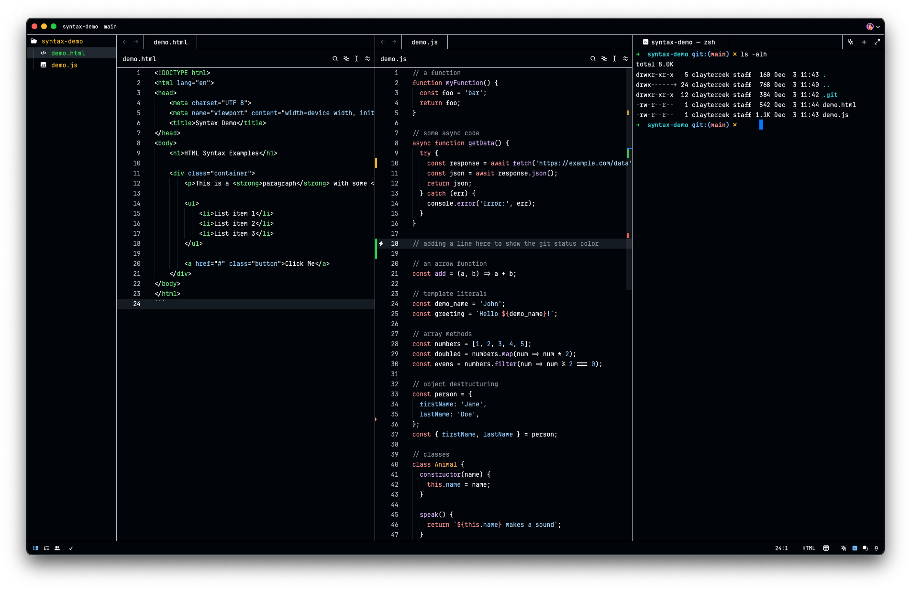

# GitHub Zed Themes

Project inspired on [GitHub's VS Code theme](https://github.com/primer/github-vscode-theme). Generated from [Primer's Primitives](https://primer.style/primitives/).

### Light



### Light High Contrast



### Dark



### Dark Dimmed



### Dark High Contrast



## Installation

1. Open `Command Palette`
2. Select `zed: extensions`
3. Search `GitHub Theme`

## Activate Theme

1. Open `Command Palette`
2. Select `theme selector: toggle`
3. Search `GitHub Light` or `GitHub Dark`

## Blurred Background

The themes use an opaque background. For a translucent, blurred window instead, add the settings below to your Zed `settings.json` (open the `Command Palette` and select `zed: open settings file`).

Each override only applies to the theme it is named after, so you can paste the whole block: only the GitHub theme you have selected is affected. If you already have `theme_overrides`, merge these entries into it.

<details>
<summary>Blurred background settings for all GitHub themes</summary>

<!-- blurred-overrides:start -->
```json
{
  "theme_overrides": {
    "GitHub Light": {
      "background.appearance": "blurred",
      "background": "#f6f8fab3",
      "title_bar.background": "#f6f8fab3",
      "title_bar.inactive_background": "#ffffffb3",
      "status_bar.background": "#f6f8fab3",
      "panel.background": "#00000000",
      "surface.background": "#00000000",
      "tab_bar.background": "#00000000",
      "tab.inactive_background": "#00000000",
      "terminal.background": "#00000000",
      "editor.background": "#ffffff80",
      "editor.gutter.background": "#ffffff80",
      "editor.active_line.background": "#f6f8fa80",
      "tab.active_background": "#ffffff80",
      "toolbar.background": "#ffffff80"
    },
    "GitHub Light Colorblind": {
      "background.appearance": "blurred",
      "background": "#f6f8fab3",
      "title_bar.background": "#f6f8fab3",
      "title_bar.inactive_background": "#ffffffb3",
      "status_bar.background": "#f6f8fab3",
      "panel.background": "#00000000",
      "surface.background": "#00000000",
      "tab_bar.background": "#00000000",
      "tab.inactive_background": "#00000000",
      "terminal.background": "#00000000",
      "editor.background": "#ffffff80",
      "editor.gutter.background": "#ffffff80",
      "editor.active_line.background": "#f6f8fa80",
      "tab.active_background": "#ffffff80",
      "toolbar.background": "#ffffff80"
    },
    "GitHub Light High Contrast": {
      "background.appearance": "blurred",
      "background": "#eff2f5b3",
      "title_bar.background": "#eff2f5b3",
      "title_bar.inactive_background": "#ffffffb3",
      "status_bar.background": "#eff2f5b3",
      "panel.background": "#00000000",
      "surface.background": "#00000000",
      "tab_bar.background": "#00000000",
      "tab.inactive_background": "#00000000",
      "terminal.background": "#00000000",
      "editor.background": "#ffffff80",
      "editor.gutter.background": "#ffffff80",
      "editor.active_line.background": "#e6eaef80",
      "tab.active_background": "#ffffff80",
      "toolbar.background": "#ffffff80"
    },
    "GitHub Light Tritanopia": {
      "background.appearance": "blurred",
      "background": "#f6f8fab3",
      "title_bar.background": "#f6f8fab3",
      "title_bar.inactive_background": "#ffffffb3",
      "status_bar.background": "#f6f8fab3",
      "panel.background": "#00000000",
      "surface.background": "#00000000",
      "tab_bar.background": "#00000000",
      "tab.inactive_background": "#00000000",
      "terminal.background": "#00000000",
      "editor.background": "#ffffff80",
      "editor.gutter.background": "#ffffff80",
      "editor.active_line.background": "#f6f8fa80",
      "tab.active_background": "#ffffff80",
      "toolbar.background": "#ffffff80"
    },
    "GitHub Dark": {
      "background.appearance": "blurred",
      "background": "#010409b3",
      "title_bar.background": "#010409b3",
      "title_bar.inactive_background": "#0d1117b3",
      "status_bar.background": "#010409b3",
      "panel.background": "#00000000",
      "surface.background": "#00000000",
      "tab_bar.background": "#00000000",
      "tab.inactive_background": "#00000000",
      "terminal.background": "#00000000",
      "editor.background": "#0d111780",
      "editor.gutter.background": "#0d111780",
      "editor.active_line.background": "#151b2380",
      "tab.active_background": "#0d111780",
      "toolbar.background": "#0d111780"
    },
    "GitHub Dark Colorblind": {
      "background.appearance": "blurred",
      "background": "#010409b3",
      "title_bar.background": "#010409b3",
      "title_bar.inactive_background": "#0d1117b3",
      "status_bar.background": "#010409b3",
      "panel.background": "#00000000",
      "surface.background": "#00000000",
      "tab_bar.background": "#00000000",
      "tab.inactive_background": "#00000000",
      "terminal.background": "#00000000",
      "editor.background": "#0d111780",
      "editor.gutter.background": "#0d111780",
      "editor.active_line.background": "#151b2380",
      "tab.active_background": "#0d111780",
      "toolbar.background": "#0d111780"
    },
    "GitHub Dark High Contrast": {
      "background.appearance": "blurred",
      "background": "#010409b3",
      "title_bar.background": "#010409b3",
      "title_bar.inactive_background": "#151b23b3",
      "status_bar.background": "#010409b3",
      "panel.background": "#00000000",
      "surface.background": "#00000000",
      "tab_bar.background": "#00000000",
      "tab.inactive_background": "#00000000",
      "terminal.background": "#00000000",
      "editor.background": "#01040980",
      "editor.gutter.background": "#01040980",
      "editor.active_line.background": "#151b2380",
      "tab.active_background": "#01040980",
      "toolbar.background": "#01040980"
    },
    "GitHub Dark Tritanopia": {
      "background.appearance": "blurred",
      "background": "#010409b3",
      "title_bar.background": "#010409b3",
      "title_bar.inactive_background": "#0d1117b3",
      "status_bar.background": "#010409b3",
      "panel.background": "#00000000",
      "surface.background": "#00000000",
      "tab_bar.background": "#00000000",
      "tab.inactive_background": "#00000000",
      "terminal.background": "#00000000",
      "editor.background": "#0d111780",
      "editor.gutter.background": "#0d111780",
      "editor.active_line.background": "#151b2380",
      "tab.active_background": "#0d111780",
      "toolbar.background": "#0d111780"
    },
    "GitHub Dark Dimmed": {
      "background.appearance": "blurred",
      "background": "#151b23b3",
      "title_bar.background": "#151b23b3",
      "title_bar.inactive_background": "#212830b3",
      "status_bar.background": "#151b23b3",
      "panel.background": "#00000000",
      "surface.background": "#00000000",
      "tab_bar.background": "#00000000",
      "tab.inactive_background": "#00000000",
      "terminal.background": "#00000000",
      "editor.background": "#21283080",
      "editor.gutter.background": "#21283080",
      "editor.active_line.background": "#262c3680",
      "tab.active_background": "#21283080",
      "toolbar.background": "#21283080"
    }
  }
}
```
<!-- blurred-overrides:end -->

</details>

- Blur needs support from your OS: it works on macOS, Windows, and Wayland compositors that support it (such as KDE Plasma). On X11 the window is see-through without blur.
- Menus, popups, and the command palette stay opaque so they remain readable.
- To change how see-through the window is, edit the last two hex digits of a color, which set its opacity (`b3` is 70%, `80` is 50%).

## Contributing

Feel free to fork, make changes, and submit a pull request.

## Development

```bash
npm install
npm run dev
```

## Publishing new versions

1. Update the version in `extension.toml`
2. Run `npm run build`
3. Commit and push your changes (make sure to push the built files in `themes/` and the updated `README.md` as well)
4. Follow the [Zed publishing docs](https://zed.dev/docs/extensions/developing-extensions#updating-an-extension) to publish the extension